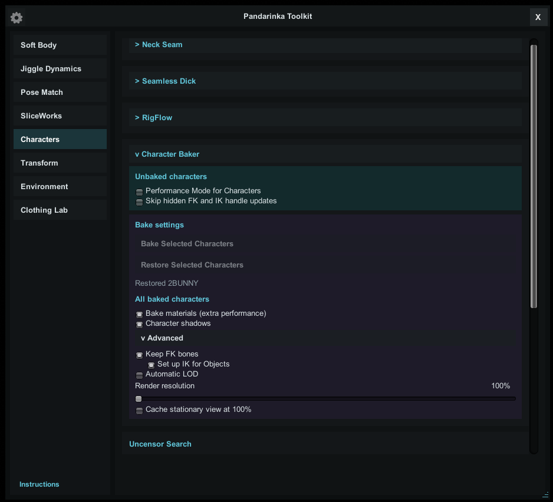

# Character Baker

  <video controls playsinline preload="metadata" poster="assets/images/character-baker-preview.jpg" width="1920" height="1080" aria-label="Character Baker demonstration">
    <source src="assets/videos/character-baker.mp4" type="video/mp4">
    <a href="assets/videos/character-baker.mp4">Open the Character Baker video</a>
  </video>

Character Baker turns each character into a separate Studio object. Use it for background characters and crowds when you want to keep their clothes, hair and expression while reducing the work Studio spends on animation and physics. By default, the object keeps FK bones so you can still adjust its pose.

[Pandarinka Toolkit on Patreon](https://www.patreon.com/Pandarinka/posts/pandarinka-and-154581882)

## Getting Started

1. Set the character's pose, expression, outfit and clothing state. Baker captures the meshes visible at that moment. Visible props attached under the character are included in the baked object. If a prop needs to stay separately selectable, move it out of the character's Workspace hierarchy before baking.
2. Select one or more characters in the Workspace. Open **Toolkit → Characters → Character Baker**, above **Uncensor Search**.
3. For a fixed pose, open **Advanced** and clear **Keep FK bones** before baking. Leave it enabled if you plan to pose the object later.
4. Click **Bake Selected Characters**. When the bake finishes, each selected character has been replaced by an object in the Workspace. You can move, rotate, scale, hide or duplicate it like other Studio objects.

## Restore a character

Select one or more baked objects and click **Restore Selected Characters**. Restore replaces each object with the character as it was at bake time, including its pose, expression, outfit and attached props. It uses the baked object's current position, rotation, scale, Workspace parent and visibility. If you also want to keep FK or material edits made after baking, duplicate the baked object first and restore just one copy.

## Scene data and backup files

When you save a scene, its PNG in `UserData/Studio/scene` contains both the baked objects and the original character data used by **Restore Selected Characters**. To share the bakes, send the scene PNG. The recipient also needs Character Baker and the mods and shaders used by the characters.

**`UserData/CharacterBaker/Originals`** holds a recovery PNG for each character you bake. After you successfully save a scene in `UserData/Studio/scene`, Baker reads the saved file and compares its embedded character snapshots with the recovery PNGs, including older ones. It automatically deletes each byte-for-byte match. Rolling saves in the Scene Browser autosave folder do not trigger cleanup. If the save fails or the snapshot is missing or different, the recovery PNG stays on disk. Restoring or deleting a baked object before saving can leave its only recovery copy here.

**`UserData/CharacterBaker/Restore`** is temporary. When rebuilding baked objects on scene load or restoring a character, Baker writes the embedded character snapshot here so Studio can import it. Baker deletes the temporary PNG after import, so the folder is usually empty.

## FK and IK on a baked object

**Advanced → Keep FK bones** applies to new bakes and starts enabled. Clothing follows the retained bones. You can pose them with FK and animate them in Timeline. Hair and clothing simulations stop at bake time, and the facial expression stays fixed.

**Set up IK for Objects** is off by default, so a new bake starts with FK controls only. To create IK targets for the detected limbs, leave **Keep FK bones** on and tick **Set up IK for Objects** before baking. Select the baked object and open **Toolkit → Transform → IK for Objects** to adjust the targets. Turning off **Keep FK bones** also clears the IK checkbox. To add bones to a fully static bake, restore the character and bake it again with **Keep FK bones** on. [IK for Objects guide](ik-for-objects.md)

## Materials and shadows

Under **All baked characters**, a change applies to existing baked characters and becomes the default for future bakes. To adjust one object, expand its row under **Baked characters**. Clicking its name selects it in the Workspace.

| Setting | When to use it |
| --- | --- |
| **Bake materials (extra performance)** | Enabled by default. Combines supported skin and clothing layers to reduce rendering work. Hair and eyes keep their original materials. Turn this off for a close-up if you prefer the original skin lighting, fabric detail or gloss. Preparing maps takes time and uses memory. |
| **Character shadows** | Enabled by default. Keep shadows on for characters whose shadows matter to the shot. Turning them off on background characters can reduce shadow rendering work. |

## Render resolution and Automatic LOD

Open **Advanced** under the global settings or inside an individual baked character's row. **Render resolution** defaults to **100%**. The other choices are **75%, 50% and 25%**. They reduce the pixels used to draw the character. The mesh, pose and material settings stay the same.

- **Automatic LOD** changes the slider to **Minimum render resolution**. With a 50% minimum, a small figure in the background can drop to 50% while a close-up stays sharp. Stop moving the camera and check the **Res** percentage beside the object's name under **Baked characters**. Setting the minimum to 100% keeps full resolution at every distance.
- While the camera moves, Baker returns to full resolution. Stop the camera to see the lower setting take effect. With Graphics SSS active, Baker uses the original rendering path.
- **Cache stationary view at 100%** is off by default. Use it for a locked camera looking at unselected, stationary extras with **Character shadows** off. Baker can reuse their last image between edits. **Orbiting can lower FPS** with this option enabled.

## Unbaked characters

You can use these two options on ordinary characters before baking anything.

- **Performance Mode for Characters** pauses pose updates for unselected characters once their body and physics have settled. Selecting a character wakes it for editing. Timeline playback wakes held characters too. **Poses held** shows how many are currently paused. A count of zero is normal while Timeline is playing.
- **Skip hidden FK and IK handle updates** skips work on hidden controls belonging to unselected characters. Selecting the character wakes its controls. This can save CPU time in a scene with many handles.

## Crowds and performance

**To build a crowd, bake one character for each distinct appearance and duplicate the baked objects in the Workspace.** This saves setup time because you load and bake each source character once. The copies share meshes and textures, which reduces RAM use. You can position each copy independently. Enable **Keep FK bones** before baking if you want to give the copies different poses.

If you bake characters separately, Baker can still use one temporary source character to rebuild matching appearances on scene load. Different baked poses can increase the scene file size. If the shared source lacks a material a character needs, Baker loads that character's own snapshot.

In a scene with eight characters, baking raised the frame rate from **35 to 120 FPS**. The gain depends on what takes time in your shot. If lighting and scene effects already take most of the frame, baking characters can make a smaller difference. To compare settings, keep the same camera, visible objects and lighting.
