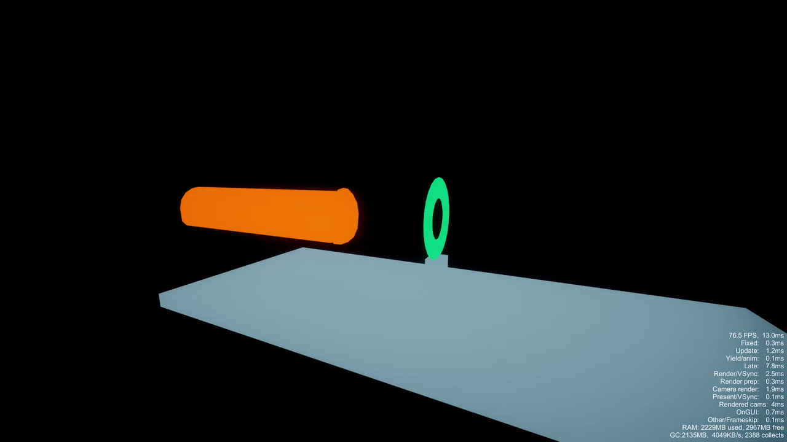

# Scale Ring

  <video controls loop muted playsinline preload="metadata" poster="assets/images/scale-ring-video.jpg" width="1920" height="1080" style="display: block; width: 100%; max-width: 100%; height: auto;" aria-label="Scale Ring demonstration video">
    <source src="assets/videos/scale-ring.mp4" type="video/mp4">
    Your browser does not support embedded video. <a href="assets/videos/scale-ring.mp4">Open the video</a>.
  </video>

**Scale Ring** is especially useful in **sex scenes** when parts of an object's mesh visibly stick out through another mesh. Place the ring at the entrance to smoothly narrow the passing section, and use **Depth compression** when you also need to hide the part farther inside. The original shape returns as the object moves back.

It also works with **tentacles, tails, cables and other flexible skinned objects**. The effect follows movement through the ring, so it can work with existing animations, pistons and gimmicks without a separate timing setup.

Open **Toolkit → Transform → Scale Ring**.

[Pandarinka Toolkit on Patreon](https://www.patreon.com/Pandarinka/posts/pandarinka-and-154581882)

## Getting started

1. Select the **mesh object** that will pass through the ring in **Workspace**.
2. Open **Toolkit → Transform → Scale Ring** and click **Create ring for this object**. The ring is created and bound to the selected object.
3. Move and rotate the ring to the entrance. Resize it to set the opening.
4. Move the affected object through the ring. It narrows near the opening and returns to its original shape when withdrawn.

Use a skinned mesh item with FK bones, such as a cable, tail or tentacle. **FK can be off** while the effect runs. Select the mesh item itself rather than a parent folder, piston or gimmick controller.

## Position and bind the ring

Select the ring and use Studio's normal position, rotation and scale controls. Its **local X and Z scale** determine the opening. Scale both equally for a round opening; local Y changes the ring's thickness.

Keep the ring independent of the moving object. You can parent the ring to another item or a receiving object's control so that it follows that entrance. Binding an affected object does **not** parent the ring to it or move either item.

### Use an existing ring

1. Select the ring and click **Bind to object** in Scale Ring.
2. Click the mesh object directly in **Workspace**.

The binding is applied immediately and the ring is selected again. **Affected object** shows its target. Press **Esc** or **Cancel** to cancel picking. Each ring has one affected object; rebinding restores the previous target.

You can also create an unbound ring with **Add ring object** and bind it afterwards.

## Effect settings

Select the **affected object** to edit the effect. Selecting the ring shows its binding instead. **Select ring object** switches back to the ring for placement.

| Setting | What it does |
| --- | --- |
| **Enable Scale Ring** | Turns the effect on or off. Turning it off restores the original mesh. |
| **Transition distance** | Sets how far before the ring the object begins to narrow. Increase it for a longer, gentler transition; decrease it to keep the change close to the opening. |
| **Depth compression** | Progressively narrows the entered part to zero and hides it farther inside. **0** disables disappearance. Higher values make it disappear closer to the ring. |

With **Depth compression** at **1**, the entered part disappears completely one Studio world unit behind the ring; at **0.5**, it disappears at two units. The outer transition is still controlled by **Transition distance**. Fully hidden faces stop rendering, including in shadows, and return as the object withdraws.

An entered part stays compressed when its animation bends it away from the entrance axis. The effect follows the bound object's skinned surfaces, while its original bones keep their animation.

### Advanced

| Setting | What it does |
| --- | --- |
| **Fit width to ring opening** | Fits the object's width to the ring. Resize the ring to change the fitted width. Enabled by default. |
| **Inside scale** | Appears when automatic fitting is off. Sets the width multiplier inside the ring: **0.5** is half width and **1** keeps the original width. |
| **Reverse entry direction** | Swaps which side of the ring is treated as inside. |
| **Entry direction bones** | Shows the bones used to determine the object's approach direction. These are direction controls, not a list of the only bones affected. |

Most chains resolve their entry direction automatically. If the panel asks for an FK point, select one near the object's entering tip and click **Use selected FK bone**. Use **Add selected bone to gate** in Advanced to add another direction bone. **Remove** removes a direction bone from the list.

The remaining skinned bones and separate skinned surfaces of the bound item are processed too. Only the portion near the transition or inside the ring changes.

## Animation and speed

Scale Ring responds to the object's position relative to the ring. It works with manual movement, Timeline animation, Studio Routes, pistons and gimmicks. It does not create the object's movement or set its playback speed.

Change the speed in the tool driving the object. For a **Studio Route**, stop playback, select its route points and change **Speed**, then press **Play** again. The mesh object's own Animation Speed does not change Route motion.

## Hide, restore and save

Hide the ring with its **Workspace eye** to keep the guide out of a render. The effect stays active. To restore the object, turn off **Enable Scale Ring** or move it fully back beyond the transition.

The ring, target binding, direction bones and effect settings are saved with the scene. Include both the ring and affected object when saving or importing the setup.

An older folder gate can be converted with **Replace folder gate with ring**. Its binding transfers to the ring; the old folder remains in the scene.

## Troubleshooting

| Problem | Check |
| --- | --- |
| **The object does not react** | Select the ring and check **Affected object**. Bind the actual skinned mesh item, then select that item and enable **Enable Scale Ring**. A plain static mesh or controller folder cannot be used as the target. |
| **The ring moves with the object** | Check Workspace parenting. Place the ring outside the moving item's hierarchy, or parent it to the receiving object instead. |
| **The wrong side is compressed** | Enable **Reverse entry direction** in Advanced. |
| **The narrowing is too abrupt** | Increase **Transition distance**. If the fitted width is too small, enlarge the ring's opening or turn off automatic fitting and adjust **Inside scale**. |
| **A part disappears sooner than intended** | Lower **Depth compression**, or set it to **0** to keep the entered part visible. |

The ring defines an entrance. It does not detect collisions against an entire receiving mesh.
