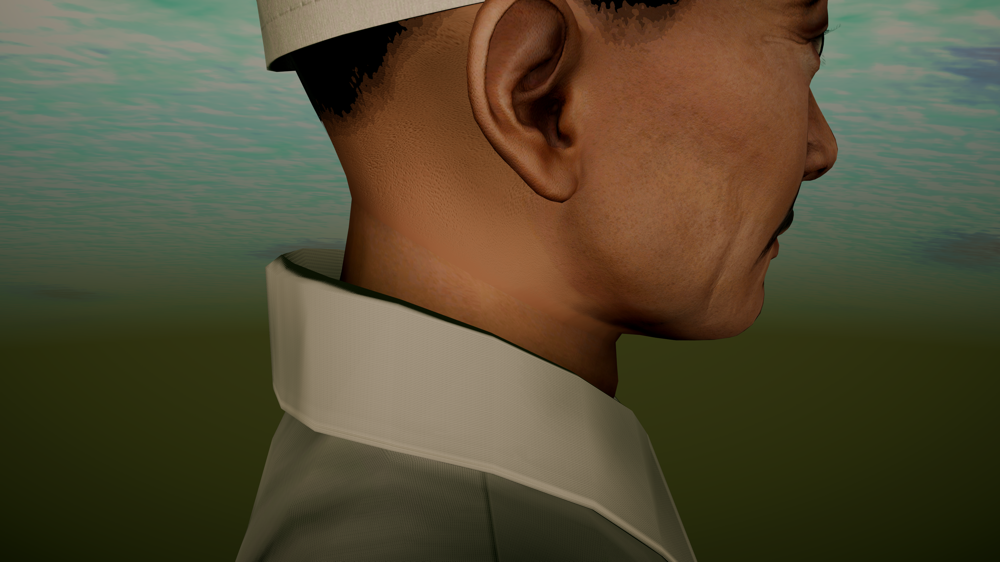
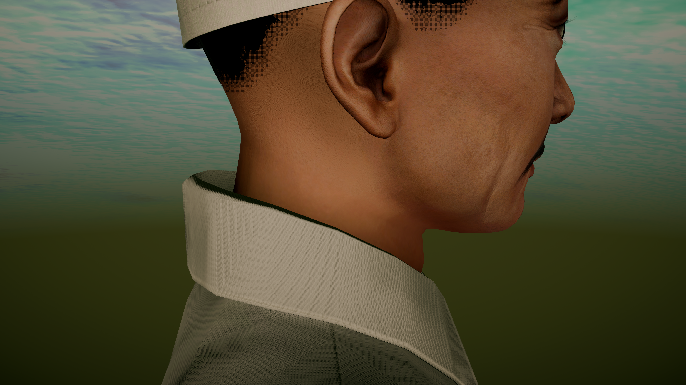
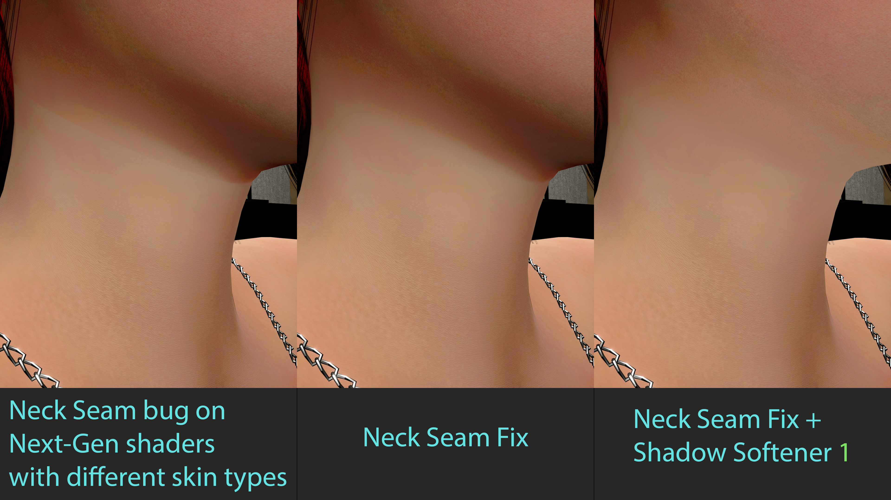
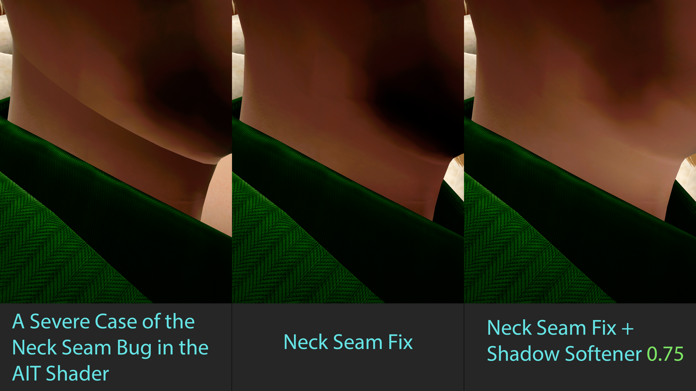
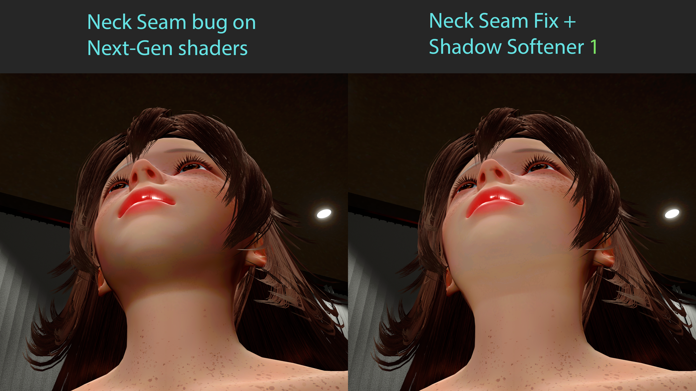

# Neck Seam

**Neck Seam** helps hide the visible line where a character's head meets the body. Use it when the skin changes colour, shine, or surface detail abruptly around the neck, making the head look separate from the body.

It also includes **Shadow Softener** for reducing a harsh shadow under the chin. The two effects are independent, so you can use either one or both.

  

    <figure>
      
      <figcaption>Before</figcaption>
    </figure>
    <figure>
      
      <figcaption>After</figcaption>
    </figure>
  

  
  
  

## Getting Started

1. Select a character in the Studio workspace.
2. Open Toolkit and go to **Characters > Neck Seam**, above RigFlow.
3. Check **Enable Neck Seam Fix** and wait for the neck transition to finish updating.
4. Adjust **Transition width** and **Blend strength** if needed.

The effect uses the character's existing skin. Disabling **Enable Neck Seam Fix** restores the original appearance.

## Application Time

**Neck Seam Fix takes roughly 8 seconds to apply per character.** Saved effects are applied again automatically when you reload the scene, so scenes with these effects can take longer to finish loading. **Shadow Softener applies instantly.**

Changes in **Material Editor (ME)** or to skin textures can make Neck Seam Fix update again. For a smoother workflow, finish adjusting your character's textures and materials first, then enable Neck Seam Fix last.

## Blend the Neck Seam

| Control | What it does |
| --- | --- |
| **Enable Neck Seam Fix** | Blends the skin transition between the head and body on the selected character. |
| **Transition width** | Controls how far the blend extends around the join. Start with the default **0.2** and widen it if the transition is too abrupt. |
| **Blend strength** | Controls how strongly the blend is applied. **1** is full strength; **0** removes the visible blend. |
| **Rebuild neck transition** | Recreates the blend from the current skin and materials. Use it if the transition looks outdated after changing the character's appearance. |

The blend works on skin colour, surface detail, and gloss where supported by the current skin materials. A wider transition is not always better: use enough width to soften the join without spreading the change farther than needed. **Default** beside a slider restores its starting value.

The panel shows when the transition is updating. If the character's geometry limits the usable width, or a material setting prevents one part of the blend, the status explains what was retained or limited.

## Soften the Shadow Under the Chin

Check **Enable Shadow Softener** in the same section, then adjust **Shadow softening**.

- **0** keeps the original shadow.
- Higher values soften the dark area under the chin more strongly.
- **Default** restores **0.65**.

Use this when the neck seam is already smoother but a heavy shadow still makes the head look disconnected. Shadow Softener can stay enabled while Neck Seam Fix is off.

## Saving and Undo

Both effects have separate settings for each character. Their on/off states and slider values are saved with the scene and carried over when importing a scene or duplicating a character.

Setting changes support Studio **undo/redo**.

## Performance

As a rough guide, each effect costs around **1–3 FPS**. The actual impact depends on your hardware, character, skin materials, and scene.

With Neck Seam Fix enabled and its update finished, click **Measure FPS impact**. Keep the camera and scene still while it compares the effect on and off. The result shows FPS and frame time for the selected character, including Shadow Softener if enabled.

Use **Stop FPS measurement** to end the comparison early.

**P.S.** Neck Seam does not fix every neck seam yet, but that is what I am working toward. If you find a bug or it does not help with your character, please contact me on [Discord](https://discord.com/invite/Ndzqjv8awk) and include your log, scene file, and screenshots. I will keep improving it in future updates.
