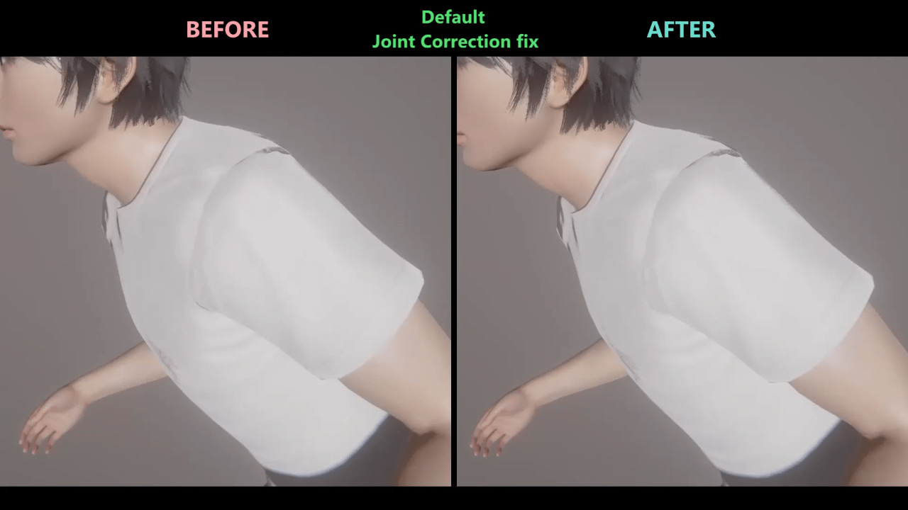

# RigFlow

  <iframe
    src="https://www.youtube-nocookie.com/embed/9XRwOOGU5XY"
    title="RigFlow video"
    allow="accelerometer; autoplay; clipboard-write; encrypted-media; gyroscope; picture-in-picture; web-share"
    allowfullscreen>
  </iframe>

**RigFlow** makes posing and animating characters much easier by combining IK and FK in one set of controls. Rotate an elbow or shoulder to adjust the connected parts, keep a hand in place while changing the arm's pose, or move both arms or legs together.

Build and adjust poses with fewer individual edits, then animate the same controls in Timeline. Optional smoothing adds a gentle delay as the character follows your controls, giving movement a softer feel without extra folders or constraints.

## Getting Started

1. Select a character and pose it with ordinary IK/FK.
2. Open Toolkit, then go to **Characters > RigFlow**.
3. Check **Enable RigFlow**. The first time, it starts from your current pose.
4. Click a point and use Studio's move or rotation handles, or **Move Controller**.

Try moving a wrist, then rotating its elbow or shoulder. The connected parts follow your edits.

**Ctrl-click** selects several points; selected points turn white. **Q / Axis** shows or hides the controls without losing your selection. Move Controller also works while they are hidden.

## Which Point Should I Use?

| To adjust… | Use… |
| --- | --- |
| The whole character | **Hips** |
| The back or upper body | **Spine 01**, **Spine 02**, **Upper Torso** |
| Both arms together | **Shoulders** |
| Both legs together | **Lower Body** |
| One arm | Its **Shoulder**, **Elbow**, or **Wrist** |
| One leg | Its **Hip**, **Knee**, or **Ankle** |
| Where the character looks | **Neck** and **Head** |

Arms are **pink**, legs **green**, and the spine **turquoise**. The two group controls, **Shoulders** and **Lower Body**, are **orange**.

Fingers, toes, and available heel bones keep their FK controls for fine adjustments.

## Keep a Point in Place

**Right-click a point** to choose which connected points follow it. You can also use the same settings under **RigFlow > Point options**.

For example, to move an arm while keeping its wrist in place:

1. Right-click **Left Shoulder**.
2. Uncheck **Follow parent** beside **Left Wrist**.
3. Move or rotate the shoulder. The elbow follows, while the wrist point stays put.

You can still move the wrist directly. Check **Follow parent** again to have it follow the elbow.

The checkbox beside **Left Elbow** controls whether it follows the **shoulder**. It does not link the elbow to itself. When you rotate a point directly, that point is the center of rotation, with Follow parent either on or off. This applies to all RigFlow points.

## Make Posing Easier

- **Joint correction** turns hands and feet with the bending limb, helping avoid awkward wrist and ankle angles. It is on by default; you can still rotate them yourself.
- **Mirror arms:** rotate **Shoulders** to move both arms symmetrically. For example, use Z to raise both arms together.
- **Mirror legs:** rotate **Lower Body** to move the legs in opposite directions. On X, one leg goes forward and the other backward.

Find the mirror switches at the bottom of **Point options**, or right-click **Shoulders** or **Lower Body**. Each limb rotates around its own shoulder or hip. Moving the group point still moves both limbs together.

Enable Toolkit's [**Joint Follow**](joint-follow.md) if you also want elbows and knees to follow along when you move wrists and ankles.

## Fix Built-in Joint Correction Glitches

If a shoulder, hip, arm, or leg suddenly twists or changes shape at certain angles, enable **Fix default joint correction glitches** under **Characters > RigFlow**. It stabilizes the game's built-in joint shape correction while keeping that correction active.

  

This is separate from **Joint correction**, which adjusts the rotation of hands and feet as a limb bends. Use the new checkbox for sudden joint flips; use the existing option for wrist and ankle alignment.

The fix is **off by default** and applies only to the selected character. You can use it without enabling RigFlow controls. It does not turn on joint correction for body parts where the game's own correction is disabled.

The setting is saved with the scene, supports **undo/redo**, and has a **RigFlow fix default joint correction glitches** track in Timeline.

## Add Smooth Movement

The damping sliders make the character catch up gradually when you move or rotate a point. **Position damping** smooths movement; **Rotation damping** smooths turning.

- **0** — immediate response. This is the default.
- **Low positive values** — slower following and a longer delay.
- **Higher values** — faster following and a shorter delay.

Use this for softer movement during animation. **Default** resets a slider to 0.

## Switch Between RigFlow and IK/FK

RigFlow remembers its own pose separately from your ordinary IK/FK pose:

- **First enable:** starts from the current IK/FK pose.
- **Turn it off:** returns to your ordinary IK/FK pose.
- **Turn it on again:** restores the changes you made in RigFlow.

Want to start over from a newly edited IK/FK pose? Click **Refer to IK/FK**. It replaces the saved RigFlow pose and enables RigFlow. You can undo this change.

**Refer to animation** copies the current animation pose instead. Loading a regular pose through Studio, **PoseLoader**, or **GlobalSearch** updates the RigFlow controls automatically.

## Bring Controls Back to the Body

If points have ended up far from their joints, press **V** or click **Recalibrate IKs**. This brings the controls back to the body without changing the visible pose.

Select the character or one of its RigFlow points first. The button is in the main panel and every point's right-click menu. Change **V** under **Options > Hotkeys > RigFlow Recalibrate IKs**.

## Animation and Saving

RigFlow works with **Move Controller**, **NodesConstraints**, **KineMod**, and **Timeline**.

In **Timeline**, select the character to animate RigFlow points and settings, including damping, mirroring, joint correction, and turning RigFlow on or off. To animate **Follow parent**, use the point's **unlinked** track: on means the point stops following; off means it follows again. You can also use selected-guide tracks or link the points through NodesConstraints.

Edits, settings, and recalibration support Studio **undo/redo**. Everything is saved with the scene, including both poses when RigFlow is turned off. Importing the scene or duplicating the character preserves the setup too.

## VNGE Support

RigFlow also works with **VNGE / VNActor** through the [RigFlow VNGE patch](https://drive.google.com/drive/folders/1ybCvB-yyWXloaTxSZwc7Bkd5AueWif5c?usp=sharing). Actor states can save and restore the RigFlow pose, on/off state, damping, point links, mirroring, and joint correction.

**The patch works only with the [latest version of VNGE](https://www.patreon.com/c360plugins/posts/vnge-v45-1-170514819).** Install VNGE first, then the RigFlow patch.

1. Close Studio and extract the patch into your game folder, replacing the files.
2. Start Studio and open **VNGE SSS > Scene Utils > VNActor**. Make sure **RigFlow pose and settings** is enabled.
3. Select your character and add it through **Tracking > Add selected** if it is not already tracked.
4. Create or update an SSS state for each pose you want to save. Existing states need to be updated to include RigFlow data.

VNGE restores saved RigFlow states. For animation of individual RigFlow controls, use **Timeline**.
