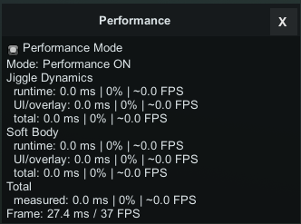

# Toolkit Options

<div class="video-preview">
  <iframe
    src="https://www.youtube-nocookie.com/embed/_Vw4AJ6jK7E"
    title="Toolkit Options video"
    allow="accelerometer; autoplay; clipboard-write; encrypted-media; gyroscope; picture-in-picture; web-share"
    allowfullscreen>
  </iframe>
</div>

**Options** is the built-in settings section inside **Pandarinka Toolkit**.

Open it with the gear button in the top-left corner of the Toolkit window.

[Pandarinka Toolkit on Patreon](https://www.patreon.com/Pandarinka/posts/pandarinka-and-154581882)

## What You Can Change

- Hotkeys.
- Window size.
- Window position.
- Window opacity.
- Soft Body selection opacity.
- Performance Monitor visibility.
- Language: English, Japanese, or Chinese.

Window size and position are saved automatically.

## Exclusive Fullscreen

**Exclusive fullscreen** lets Studio take control of the display mode on the monitor containing its window. Toolkit reads that monitor’s desktop resolution and refresh rate from Windows. If you use several monitors, move Studio to the one you want to use before enabling the setting.

Open the gear in the top-left corner of Toolkit and tick **Exclusive fullscreen**. The change applies as soon as Studio has focus. The line below the checkbox shows the active resolution and refresh rate. You can also find the same setting in **F1 → Pandarinka Toolkit → Display** if you use Configuration Manager.

The setting is off by default. Once enabled, it applies again on future Studio launches when the window gains focus. Clear the checkbox to return to your previous display mode. If the checkbox is ticked and a red message says exclusive fullscreen is inactive, turn it off and back on.

**FPS gains vary by scene.** In one test, switching to exclusive fullscreen raised the frame rate from **60 to 120 FPS**. A heavier scene gained **about 10 FPS**. To check the difference in your own scene, compare the same camera view with the setting off and on, keeping Studio in focus for both readings.

## Default Shortcuts

```text
T: Toolkit window
Shift + P: Pose Match
Keypad1: Pose Match IK
Keypad3: Pose Match FK
U: Drop to Surface
V: Soft Body selection visibility
V: RigFlow Recalibrate IKs
B: Soft Body paint selection
N: Soft Body erase mode
O: Jiggle contact areas
Snow Field Footprint: set it here before placing footprints
Performance Monitor: not assigned by default
```

You can change these shortcuts in **Options**. Press **Set** near the shortcut you want to change, then press the new key combination. Use **Default** to restore one shortcut, or **Off** to disable it.

## Performance

<div class="guide-image">
  
</div>

The **Performance Monitor** is a small separate window for checking how much time Toolkit features spend each frame.

It shows **Jiggle Dynamics**, **Soft Body**, FPS, and timing information. Recent versions show more accurate FPS and timing numbers, so it is easier to see what is actually adding cost.

**Performance Mode** reduces Soft Body overlay detail and reuses static painted shapes when possible. It is enabled by default, and it is always better to keep it enabled.

## Toolbar Icons

Pandarinka Toolkit adds a Toolkit icon to the Studio toolbar.

It also adds a Pose Match icon that opens the Toolkit directly on the **Pose Match** page.

## Tooltips

Tooltips are available throughout the Toolkit window.

Hover over a setting to see a short explanation of what it does. This is useful in sections with many sliders, such as **Environment**, **Soft Body**, and **Jiggle Dynamics**.
